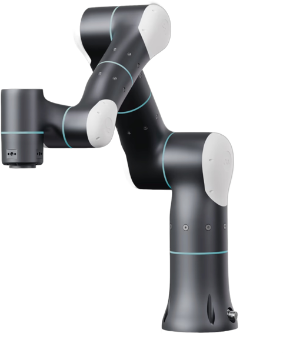

### Meeting Announcement

* When: Thursday, November 12, 2026, 7:00 to 9:00pm
* Where: [Artisans Asylum](https://www.artisansasylum.com) (96 Holton Street, Boston, MA 02135))
* Register: [Register](https://brh.eventbrite.com)

### Agenda

* 7:00 Mingle, network, show and tell
* 7:30 Short Talk: Husan Mavlonov, "Robots for Connector Assembly"
* 7:50 Featured Speaker: Yun Chang
* 8:35 Q&A and Open Discussion
* 9:00 End of formal meeting

### Featured Talk

#### Robot Scene Understanding for Extreme Environments: from subterranean to heavy equipment

What does it take for a robot to carry out a general task in any scene? This question is especially important as we see modern day robots showing more and more capabilities. This talk argues that robot perception should compress and organize raw sensor data into a representation best suited to the task, and presents 3D scene graphs as one general answer. 

We cover Hydra, which builds hierarchical scene graphs in real time; Clio, which keeps only task-relevant objects using the Information Bottleneck; and ASHiTA, which grounds high-level instructions by solving for the task breakdown and the scene graph together. We then look at field deployments, from multi-robot missions to an autonomous loader, and close with open questions about connecting scene graphs to learned robot policies.
Watch highlights from both efforts:

* [DARPA Subterranean Challenge](https://www.youtube.com/watch?v=s_1roVVAXNU)
* [Autonomous heavy equipment](https://youtu.be/K1Y4iOUN7iU)

#### Speaker: Yun Chang

Yun spent a decade at MIT earning a Bachelor's, Master's, and PhD, working in the SPARK Lab under Professor Luca Carlone. The research centered on robot perception — compressing the world into representations a machine can act on. Yun is now co-founding a stealth startup bringing autonomy to the large machines that run society's infrastructure.

### Short Talk

#### Robots for Connector Assembly

Plugging in a wire-harness connector is still one of the last hand jobs on the factory line. The cable bends, the latch hides, and a part that looks seated often isn't. This talk shows how Defex Robotics approaches it: finding a flexible harness with a camera, guiding the insertion by force and torque, and checking every connection once it clicks. I'll cover where vision alone falls short at tight tolerances, and what we learned building the loop in simulation.

#### Speaker: Husan Mavlonov

Husan Mavlonov is the co-founder and CEO of Defex Robotics in San Francisco, which builds a robot that plugs in connectors and checks every connection. He has 3+ years in electronics and battery manufacturing, with factory work in Uzbekistan, Turkey, China and the US, and judges robotics and AI hackathons including HackHarvard, Cal Hacks and DAHacks.