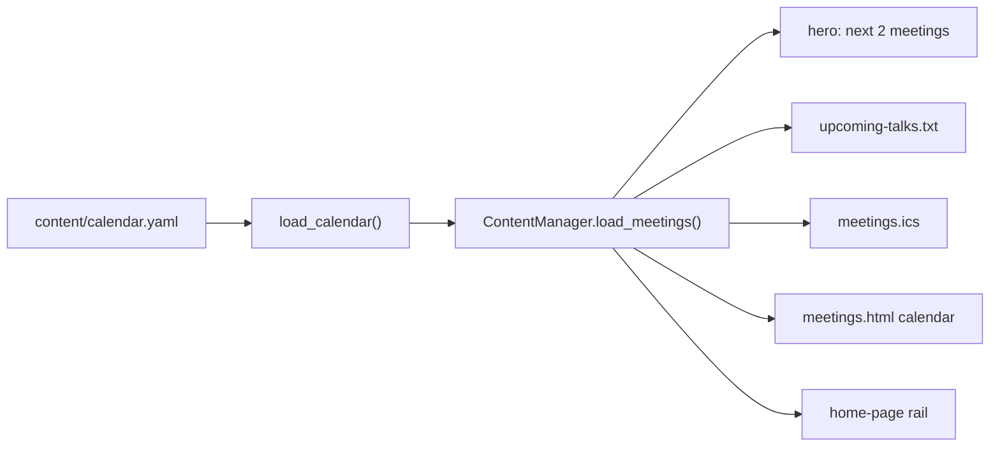

# calendar_source — one YAML file as the meeting schedule

## What this module does

The meeting schedule used to be 35 Markdown files, one per meeting, plus a
Google Sheet that drifted out of sync with them. `calendar_source` replaces
all of that with **one hand-edited file**, `content/calendar.yaml`, and one
function, `load_calendar`, that turns it into meeting dicts.

Everything meeting-shaped downstream (the hero, `upcoming-talks.txt`,
`meetings.ics`, the calendar page, the home-page rail) reads through this
loader via `ContentManager.load_meetings`.



## The file's shape: defaults plus overrides

Most meetings look alike: same place, same time per kind, same hands-on
blurb. So the file has a **`defaults` block** and a **`meetings` list**, and an
entry only needs to state what's different about it.

An excerpt from the real file:

```yaml
defaults:
  location: "Artisans Asylum, 96 Holton Street, Allston"
  main:
    time: "7:00pm"
    text: "Speaker and topic to be announced."
  handson:
    time: "6:00pm"
    text: "These meetings have no agenda or speaker. Just hacking together. ..."
    announcement: "6-hands-on-meeting.md"

meetings:
  - id: 2-meeting
    date: 2025-10-09
    kind: main
    text: "Affordable Biomimetic Robot Hands"
    announcement: "10-meeting-announcement.md"

  - id: 3-handson-meeting
    date: 2025-10-23
    kind: handson
```

The minimum entry is just `date` and `kind`, like the hands-on meeting
above. A TBA talk is the same: with no `speaker`, `topic`, or `text`, it
picks up the main default "Speaker and topic to be announced." and the rest
of the pipeline treats it as not announced yet.

## Merging: a three-layer lookup

Each field resolves through **three layers, most specific wins**:

1. the entry itself,
2. `defaults.<kind>` (e.g. hands-on's `time` and `text`),
3. the top level of `defaults` (e.g. `location`).

The code is a single dict merge. Later dicts override earlier ones, so the
order of the spread *is* the precedence rule:

```python
shared = {key: defaults[key] for key in DEFAULTABLE_FIELDS & set(defaults)}
metadata = {**shared, **(defaults.get(kind) or {}), **entry}
```

- `shared` is filtered to `DEFAULTABLE_FIELDS`, so the per-kind sub-blocks
  (`main:`, `handson:`) don't leak into a meeting as stray keys.
- This is the same *layered configuration* idea as CSS cascade or
  `ChainMap`, done eagerly because the data is tiny.

## Stable ids: the `.ics` UID contract

A meeting's `id` becomes its event **UID** in `meetings.ics`. Calendar apps
that subscribe to the feed use the UID to recognize an event they've already
seen. Change it, and every subscriber gets a **duplicate event**.

So there are two id rules:

- **Migrated meetings keep their old id** (`24-meeting`, `27-handson-meeting`)
  through an explicit `id:` field, because those UIDs are already out in the
  world.
- **New meetings** omit `id:` and get one derived from the data:

```python
meeting_id = str(entry.get("id") or f"{metadata['date']}-{kind}")
```

A derived id like `2026-12-10-main` is unique as long as there's at most one
meeting of each kind per day. The loader checks that rather than assuming it:
a repeated id fails the build.

The id also becomes the **anchor** on the calendar page
(`meetings.html#<id>`), which is where links go when a meeting has no
announcement post.

## Validation: strict, once, at the boundary

The file is hand-edited, which makes it the place typos come in. Following the
project's *report, don't guess* rule, the loader rejects anything unexpected
and names the entry:

| Problem | Example message |
|---|---|
| Unknown top-level key | `calendar.yaml: unknown top-level keys ['meeting']` |
| Unknown key in defaults | `calendar.yaml: unknown keys in defaults ['tme']` |
| Unknown key in an entry | `calendar.yaml: meeting #12: unknown keys ['speakr']` |
| Bad kind | `... 'kind' must be 'main' or 'handson', got 'hands-on'` |
| Missing or non-ISO date | `... invalid date '12/10/2026': expected YYYY-MM-DD` |
| Repeated id | `calendar.yaml: duplicate meeting id '24-meeting'` |

**Unknown-key checks are the important ones.** Without them, `speakr: Jane`
would load fine and the talk would silently stay "TBA". Closed key sets
(`ENTRY_FIELDS`, `DEFAULTABLE_FIELDS`) turn that silent bug into a build
failure.

Errors are numbered by position (`meeting #12`) because a new entry may not
have an id to name it by.

## Dates: YAML's helpful parsing, normalized

YAML turns `date: 2026-12-10` into a Python `date`, but a quoted date stays a
string. The loader handles both the same way: `str()` then
`date.fromisoformat`. It stores the result twice:

- `date_obj`: a real `date`, for sorting and today-comparisons.
- `metadata["date"]`: the ISO string, which templates and older code expect.

## Output shape

Every meeting is `{"id", "date_obj", "metadata"}`, sorted by date ascending.
That's the same shape the old per-file loader produced, which is why the
consumers barely changed when the source moved.

## Observations and possible improvements

1. **A missing `calendar.yaml` returns no meetings** instead of raising. That
   kept the old "no `meetings/` directory" behavior, but on this site a missing
   schedule is almost certainly a mistake, and the build would then quietly
   ship an empty calendar.
2. **Kind is validated twice.** `build_meeting` checks `kind`, and
   `content_manager.classify_meeting` checks it again on every call. Since the
   loader is now the only way in, the second check is redundant.
3. **Defaults values aren't type-checked.** A `time: 7` (an int) would pass
   here and only fail later in `parse_meeting_time`. Checking at load would
   keep all calendar errors in one place.
4. **Duplicate-id detection covers derived ids too**, so two `main` meetings
   on one date fail with a "duplicate id" message. The real problem there is
   "two meetings on one date", so the message could say that.
