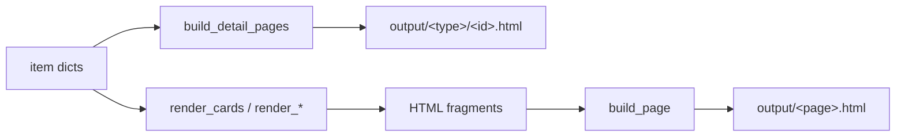
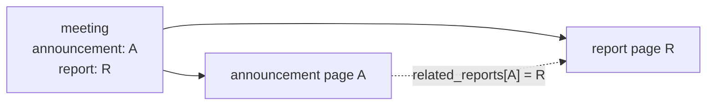

# page_builder — rendering content dicts into HTML

## Role in the build

`content_manager` produces dicts; `page_builder` turns them into HTML using
Jinja templates and writes files into `output/`. It owns three kinds of work:

- **Detail pages**: one HTML file per item (`output/news/<id>.html`, and so on).
- **Card fragments**: HTML snippets (news cards, project cards) that a listing
  page embeds.
- **Calendar data**: meetings split into upcoming and past for the calendar
  page.
- **Whole pages**: a template plus context written to one output file.



## Banners: override with fallback

Every page shows a banner image with a title. `resolve_banner` lets any page
override it from its own frontmatter and otherwise falls back to site defaults:

```python
image = metadata.get("banner_image") or self.site_config.get(
    "default_banner_image", ""
)
```

The subtle part is **`path_prefix`**. Images are specified relative to the site
root, but a detail page lives one directory deeper, so it must reference
`../images/...`. The prefix is applied to whichever image wins, override or
default, so authors never have to think about page depth.

## Detail pages: one generic loop

`build_detail_pages` renders every item of a content type with that type's
detail template:

- Dates are pre-formatted for display.
- The item is passed under the name its template expects (`post`, `project`,
  `member`), via a small lookup table.
- Banner context and any extra context (cross-link maps) are merged in.

Meetings no longer have detail pages; each one lives as an anchored entry on
the calendar page instead.

The lookup table for the variable name is a *table-driven* substitute for a
branch per type.

## Meeting cross-links

Meetings connect to news posts in two directions, and the module resolves both
from **the meeting's own fields only**, so nothing is maintained twice.



- `resolve_announcement_report` gives a meeting's templates
  `announcement_exists`, `report_html`, `slides_pdf`, and so on. It takes an
  optional key prefix, which no caller uses any more.
- `build_related_reports_map` inverts that relation, so an **announcement page
  can link forward to its report** without the announcement file having to know
  the report exists.

The slides PDF lookup deliberately suppresses `ValueError`: a missing slides
file means "no download button", not a failed build.

## Cards

`render_cards` is the generic fragment renderer. It supports two template
styles:

- **Nested**: the template expects `project.title`, so the item is passed under
  a name.
- **Flat**: the template expects `title` directly, so the item's keys are spread
  into the context.

Thin wrappers (`render_news_cards`, `render_member_cards`, …) adapt specific
content (for example flattening member metadata into `name`, `hashtags`,
`card_text`) and pick the template.

## The calendar page: upcoming, then past

`meetings.html` shows main meetings as a grid of cards. It used to group
meetings into one card per month, with client-side JavaScript for sorting and
filtering. Now the split happens at build time, in `calendar_sections`:

```python
entries = [
    self.calendar_card(meeting)
    for meeting in sorted(meetings, key=lambda meeting: meeting["date_obj"])
    if meeting["metadata"]["kind"] == "main"
]
future = [entry for entry in entries if entry["date_obj"] >= today]
return {
    "to_announce": [e for e in future if not e["metadata"].get("topic")],
    "upcoming": [e for e in future if e["metadata"].get("topic")],
    "past": [entry for entry in entries if entry["date_obj"] < today][::-1],
}
```

- **Hands-on meetings are left out.** One line from `config/site.json` describes
  their schedule instead. Their dates remain on the home page and in both feeds.
- **Meetings with no topic get no card.** They go in `to_announce`, a single line
  of dates, so the grid has no empty cards.
- **Two orders from one sort.** Upcoming reads soonest-first, past reads
  newest-first, so the past list is the ascending slice reversed.
- **`today` is a parameter**, like the feed builders, so tests can freeze the
  split date.
- The returned dict is spread straight into `build_page` as template context.

Doing this at build time instead of in the browser drops the JavaScript
entirely. The tradeoff is that "upcoming" is as of the **last build**, not the
moment someone views the page.

### What a card adds

`calendar_card` adds what the template needs to each meeting:

- **Links** to the announcement and report, so the template reads
  `meeting.announcement_exists` directly.
- **An image**, taken from the linked announcement. Meetings have no image field
  of their own.
- **Card text**, which is `blurb`, else `text`. A meeting with no topic gets
  neither, because its `text` is only the to-be-announced default.

## The home-page rail

`render_upcoming_meetings_calendar` shows meetings in a **60-day window** from
today, both kinds, with an announcement link when one resolves. It's a
sliding-window filter over the meeting list followed by a sort.

## Observations and possible improvements

1. **The file is just past the ~300-line guideline** (about 320 lines, down
   from 390). Meeting-specific rendering (calendar split, rail, cross-links)
   could still move to its own module.
2. **Two "upcoming" definitions exist.** The rail uses a 60-day window here,
   while `content_manager.get_future_meetings` has no window. That's a real
   product difference, but the date filtering itself is duplicated.
3. **`build_page` and the `.txt`/`.ics` builders overlap.** All three render a
   template with `site` in context and write a file; only the encoding differs.
   An `encoding`/post-process parameter would let the feeds reuse it.
