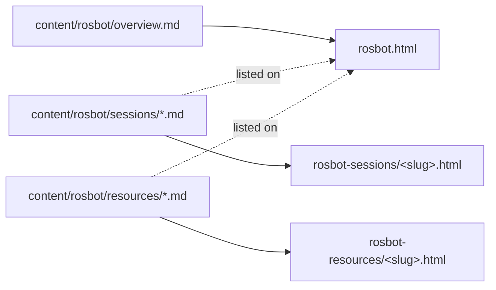

# rosbot_builder — a program section made of folders

## What it does

`rosbot_builder.py` builds the **Build-A-ROSBot** section of the site. The
section is a small, self-contained mini-site: one overview page, one page per
session, and one page per resource.

The design goal is that **adding a page is a content change, not a code
change**. The organizer drops a Markdown file into a folder, and the next
build places it in the right order, links it from the overview, and wires up
its neighbours.

## The shape of the section

Three sources map to three kinds of output:



- **The overview** is hand-written text followed by two *generated* lists.
- **Sessions** form a sequence, so each page links to the previous and next.
- **Resources** are a flat reference shelf with no sequence.

### Why the output folders are flat

The output folders are `rosbot-sessions/` and `rosbot-resources/`, not
`rosbot/sessions/`. Every detail template on the site assumes it sits **one
level deep**, and prefixes shared links with `../`:

```python
SESSIONS_OUT = "rosbot-sessions"
RESOURCES_OUT = "rosbot-resources"
```

Nesting two levels would mean teaching the nav, banner, and asset links a
second prefix. Flat folders keep the existing `is_detail_page` convention
working unchanged.

## Loading: validate once, at the boundary

All three page kinds go through one loader, which leans on
`ContentManager.process_markdown_file` and adds the one check every page
needs:

```python
def load_page(self, md_file: Path) -> dict:
    page = self.content_manager.process_markdown_file(md_file)
    if not page["metadata"].get("title"):
        raise ValueError(f"{md_file}: missing required 'title'")
    return page
```

- **Why check `metadata`, not `page["title"]`**: `process_markdown_file`
  fills a missing title with `"Untitled"`. Only the raw frontmatter still
  shows the omission, so that's where the check looks.
- **Errors name the file**: a bad page stops the build and says which file
  to fix, rather than publishing something half-right.

`load_folder` applies the loader to a folder, skipping files that start with
`_`. That is the same *scaffolding convention* `content/projects/_template.md`
uses: templates live next to real content but are never published.

### Integers that mean something

`session` and `order` are **ordering keys**, so they must be real integers.
One small helper enforces that:

```python
def require_int(page: dict, field: str, source: Path):
    value = page["metadata"].get(field)
    if not isinstance(value, int) or isinstance(value, bool):
        raise ValueError(f"{source}: '{field}' must be an integer, got {value!r}")
```

- **The `bool` trap**: in Python, `bool` is a subclass of `int`, so
  `isinstance(True, int)` is true. YAML turns `session: yes` into `True`, and
  without the second check it would quietly sort as session 1.
- **No coercion**: `session: "2"` is rejected, not converted. Guessing intent
  would hide a typo.

## Ordering

### Sessions: a number is an identity

Sessions are keyed by their `session` number, which doubles as the
**duplicate detector**:

```python
by_number: dict[int, tuple[Path, dict]] = {}
for source, page in self.load_folder("sessions"):
    require_int(page, "session", source)
    number = page["metadata"]["session"]
    if number in by_number:
        raise ValueError(...)
    by_number[number] = (source, page)
return [by_number[number][1] for number in sorted(by_number)]
```

- A dict keyed by number gives *O(1)* collision checks and sorting in one
  structure.
- The stored `source` path is what makes the duplicate error useful: it names
  **both** files that claim the same number.
- Filenames don't matter for order. `01-` prefixes are only for the
  organizer's own browsing.

### Resources: ordered first, alphabetical after

Resources have an *optional* `order`. The sort key is a **tuple**, which
Python compares element by element:

```python
def resource_sort_key(page: dict) -> tuple:
    order = page["metadata"].get("order")
    return (order is None, order or 0, page["title"].lower())
```

| Resource | Key | Position |
|---|---|---|
| `order: 1` | `(False, 1, "parts")` | first |
| `order: 2` | `(False, 2, "...")` | second |
| no order | `(True, 0, "alpha")` | after all ordered ones, by title |

- `False < True`, so ordered resources come first.
- `order or 0` keeps the middle element comparable when `order` is `None`.
- `.lower()` makes the alphabetical tail case-insensitive.

## Rendering

`build()` loads everything first, then writes. Loading first means **a bad
file fails the build before any section page is written**, so the output is
never a mix of old and new.

### Neighbours by index

Each session gets its previous and next session as template context:

```python
for i, session in enumerate(sessions):
    self.write_detail(
        "details/rosbot-session-detail.html",
        SESSIONS_OUT,
        session,
        previous=sessions[i - 1] if i > 0 else None,
        next_session=sessions[i + 1] if i + 1 < len(sessions) else None,
    )
```

- **The `i > 0` guard matters**: `sessions[-1]` is valid Python and would
  make the first session's "previous" the *last* one.
- `next_session`, not `next`, so the template variable doesn't shadow a
  Python builtin name in a reader's head.

### One writer for both detail kinds

`write_detail` creates the output folder, applies banner overrides with the
`../` prefix, and delegates to `PageBuilder.build_page`. Sessions and
resources differ only in template and folder, so one helper serves both.

The overview is a plain `build_page` call that passes the sorted lists. The
template prints each list only when it is non-empty.

## Observations

- **The markdown processor isn't shared**: each file builds a fresh
  processor. That's fine at this scale,
  and keeps the table-of-contents state from leaking between files.
- **Session dates are free text in each file**: they aren't tied to
  `calendar.yaml`, so a rescheduled meeting must be updated in two places.
  Linking a session to a calendar entry would remove that duplication.
- **The section name is hard-coded**: `rosbot` appears in folder names,
  templates, and the nav. A second program would want a small config object
  instead of a copied module.
- **No cross-links from sessions to resources**: a session that needs the
  parts list links to it by hand. A `resources:` frontmatter list could
  generate those links.
